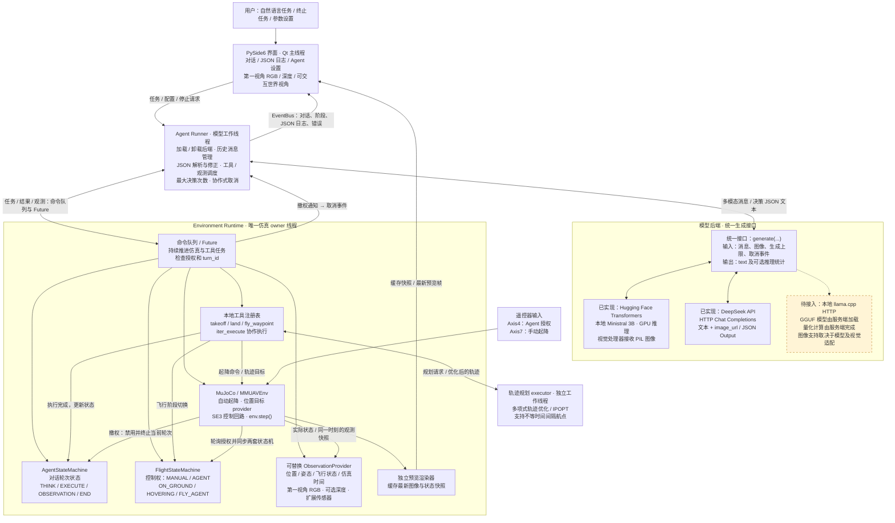
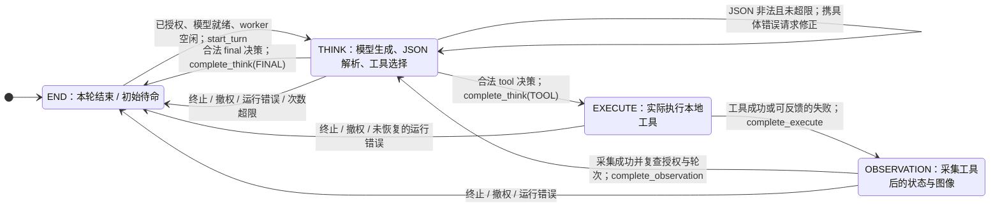
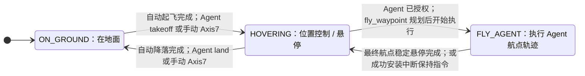
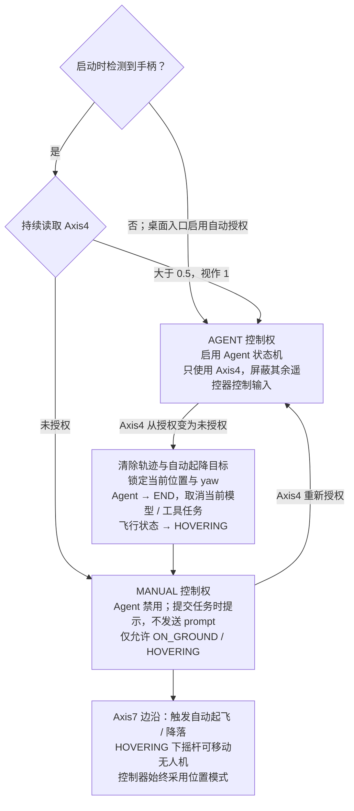
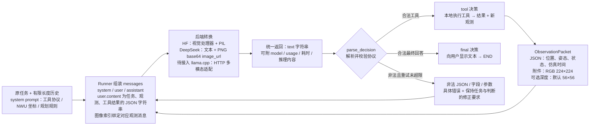

# 无人机 Agent 工程架构

本文对应当前代码。图中实线表示已实现的调用或数据流，虚线表示待接入模块或注释关联。Mermaid 图可在 GitHub 或支持 Mermaid 的 Markdown 预览中查看。

## 1. 总体架构与线程分工



Runner 不直接调用 `env.step()`，也不直接修改状态机。桌面运行时，状态机修改、工具任务推进、观测采集及 renderer 生命周期均归环境线程；轨迹优化等待和模型推理期间，仿真仍持续运行。Qt 线程读取缓存并发送请求，不访问实时 `MjData`。工具的同步 `execute()` 仅保留给无 runtime 的独立脚本和测试。

对应入口：[`app.py`](../app.py)、[`agent/runner.py`](../agent/runner.py)、[`agent/backends.py`](../agent/backends.py)、[`runtime/environment.py`](../runtime/environment.py)、[`ui/main_window.py`](../ui/main_window.py)。llama.cpp 目前尚无后端适配器或界面选项；图中仅标出将来的接入位置，后续需适配统一 `generate` 接口。

## 2. Agent 状态机：一轮对话的生命周期



源码：[`agent/state_machine.py`](../agent/state_machine.py)。状态类只负责状态与转换校验，模型调用和任务取消由 runner/runtime 实现。

- `END` 是初始状态；只有 `END` 且 Agent 已启用才能 `start_turn()`，每轮递增 `turn_id`。应用还要求模型就绪、上一项后台工作已退出，因此逻辑上进入 `END` 不代表可以立即并发发起下一轮。
- `THINK` 包含生成、JSON 解析和工具调用决策；实际工具执行属于 `EXECUTE`。JSON 修正不切换状态，保留原任务和观测，返回具体错误与“请修正上一条回复的 JSON 格式，保持原任务和判断不变”。当前解析器也兼容单个完整的 Markdown JSON 代码块。
- 初次 `begin_turn()` 在进入 `THINK` 后采集初始观测；只有工具后的反馈采集走 `OBSERVATION`。观测采集函数失败时本身保留该状态，桌面 runner 捕获异常后请求终止本轮。
- `terminate(reason)` 可从任意状态进入 `END`；`set_enabled(False)` 同时终止并禁止开始新轮次。恢复授权只重新启用 Agent，不自动继续旧轮次。
- 取消是协作式的：HF 在生成步间检查事件，HTTP 后端取消请求；已提交的 GPU / IPOPT 运算无法保证立即退出。`turn_id` 与授权复查阻止迟到结果执行工具或覆盖新轮次。

## 3. 无人机状态机与手动 / Agent 控制权





源码：[`env/flight_state_machine.py`](../env/flight_state_machine.py)、[`env/mmuav_env.py`](../env/mmuav_env.py)。控制权是 `ControlMode` 字段，与三种飞行状态共同维护；不是第四种飞行状态。

- 禁止 `ON_GROUND ↔ FLY_AGENT` 直接切换，必须经过 `HOVERING`。手动模式不能进入 `FLY_AGENT`；手动移动仍标为 `HOVERING`。
- 起飞 / 降落执行期间保留原飞行状态，完成后才变为目标状态。`fly_waypoint` 仅从 `HOVERING` 开始，规划时保持位置，执行轨迹时进入 `FLY_AGENT`。
- 最终航点的位置、速度、yaw、角速度均满足容差，且连续稳定 `hover_seconds`（默认 1 秒）后，航点工具返回成功：飞行状态进入 `HOVERING`，Agent 进入 `OBSERVATION`。中间航点不逐个悬停。
- 工具超时 / 异常会尝试安装当前位置保持指令；不能把失败或超时视为到达目标。保持失败时可能保留原飞行状态，并在结果中报告 `hold_error`。撤权则优先恢复手动目标，旧工具不得覆盖它。
- 当前撤权实现会强制进入 `HOVERING`，即使之前在地面；该状态表示位置保持控制语义，不是接触传感器对离地或稳定性的确认。
- 桌面入口无手柄时自动授权，既不自动起飞也不自动推理；终止按钮仍可用。此行为由 `auto_agent_without_joystick=True` 开启，独立构造环境的默认行为不同。

### 两个状态机如何配合

| 事件 | Agent 状态 | 无人机状态 |
| --- | --- | --- |
| 接收任务并采集初始观测 | END → THINK | 保持当前状态 |
| 选择 takeoff | THINK → EXECUTE | 执行时 ON_GROUND，完成后 HOVERING |
| 选择 fly_waypoint | THINK → EXECUTE | 规划时 HOVERING，飞行时 FLY_AGENT |
| 航点完成并稳定悬停 | EXECUTE → OBSERVATION | FLY_AGENT → HOVERING |
| 选择 land 并完成 | THINK → EXECUTE → OBSERVATION | HOVERING → ON_GROUND |
| 工具后观测采集完成 | OBSERVATION → THINK | 保持当前状态 |
| 模型输出 final | THINK → END | 保持当前状态；不会自动降落 |
| 用户终止 | 任意状态 → END | 取消运动并保持位置；运动中转为 HOVERING |
| Axis4 撤销授权 | 任意状态 → END，并禁用 | 强制 HOVERING，恢复手动控制 |

## 4. 模型与 Agent 的通信格式



### 发给模型的文本与图像

以下是首条 `user.content` 解析后的示例；在实际 `messages` 中该对象被序列化为 JSON 字符串。图像通过附件传送，不把 base64 混入文本 prompt。

```json
{
  "task": "向北飞行 1 米",
  "observation": {
    "type": "uav_observation",
    "schema_version": 1,
    "sim_time_seconds": 12.5,
    "coordinate_frame": "NWU",
    "position_m": [0.0, 0.0, 1.0],
    "attitude": {
      "quaternion_wxyz": [1.0, 0.0, 0.0, 0.0],
      "euler_rpy_rad": [0.0, 0.0, 0.0],
      "rotation_convention": "body_to_world; Rz(yaw) Ry(pitch) Rx(roll)"
    },
    "flight_state": "hovering",
    "rgb": {
      "camera": "fpv_camera",
      "width": 224,
      "height": 224,
      "color_space": "RGB",
      "mime_type": "image/png",
      "encoding": "attachment",
      "attachment": "rgb"
    }
  }
}
```

工具后的同类消息额外带 `tool_result`，并再次带上原 `task`。最新 RGB / 可选深度始终绑定该条观测；JSON 修正消息不会改变绑定。旧观测文本保留，旧图像标记 `not_retained`，不重复发送附件。`ObservationPacket.to_json()` 也支持自包含 PNG/base64 JSON，但桌面 runner 使用附件路径。

深度默认不发送，开启后附加 `observation.depth` 元数据和第二张图：相机前向 Z 深度（米），灰度固定编码 0～10 米，白近黑远，附 3×3 区域最近深度等统计。模型观测分辨率与界面预览分辨率独立。未来点云可通过替换 `ObservationProvider` 或 `extra_sensors → extras` 扩展，当前尚未实现点云观测。

### 模型返回的决策

每次只返回下列四类对象之一，无额外字段；当前使用自定义 JSON 决策协议，不是 OpenAI 原生 `tool_calls` / `role=tool` 消息协议。DeepSeek 的 JSON Output 只要求对象格式，工具字段和参数合法性仍由本地校验。

```json
{"tool":"takeoff"}
```

```json
{"tool":"land"}
```

```json
{"tool":"fly_waypoint","waypoint":[{"time":3.0,"position":[0.4,0.0,1.0],"yaw":0.0},{"time":5.5,"position":[1.0,0.0,1.0],"yaw":0.0}]}
```

```json
{"final":"已完成任务。"}
```

`waypoint` 必须是显式非空数组，数量由模型决定；`time` 是相对此次工具开始的秒数，必须为正且严格递增，间隔可不同。`position` 是世界系绝对坐标（米），NWU 的 +X 向北、+Y 向西、+Z 向上；`yaw` 单位为弧度。前后左右需按任务开始时的 yaw 换算为世界目标，不能直接当世界轴方向。

`tool_result` 的字段随工具及结果不同，状态包含 `success`、`timeout`、`error`、`terminated`。例如航点成功结果带实际位置、yaw、误差、执行时长和稳定悬停时长。Runner 将结果作为观测消息中的 JSON 数据回传，模型应据实际状态判断完成，而不是把合法调用或 `final` 文本当作已到达的证明。

通信实现见 [`agent/protocol.py`](../agent/protocol.py)、[`agent/messages.py`](../agent/messages.py)、[`observations/base.py`](../observations/base.py)、[`agent/ministral.py`](../agent/ministral.py)、[`agent/deepseek.py`](../agent/deepseek.py)。当前轨迹优化器不包含障碍约束或碰撞检测；RGB / 深度与提示词支持模型规划，但不构成可靠避障保证。
