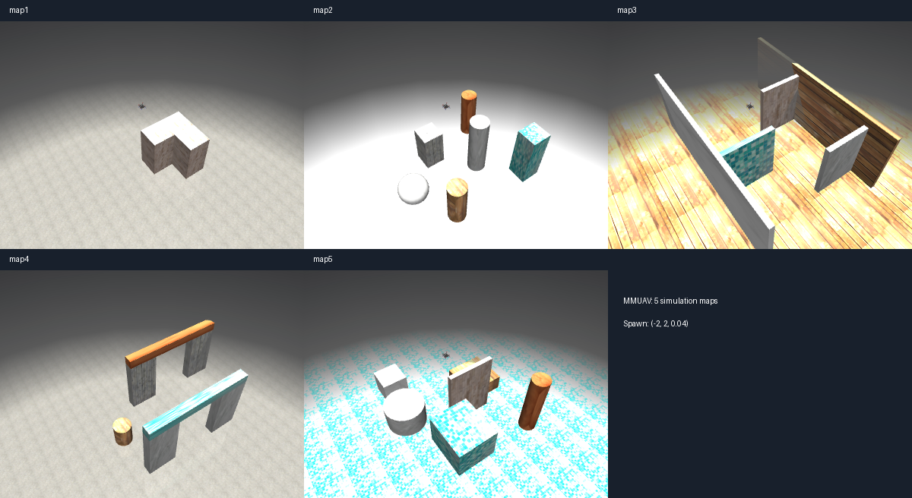

# 地图选择与重载

启动 `python app.py`，在顶部“仿真地图”下拉框选择地图，再点击“重载环境”。选择下拉选项本身不会切换；选择当前地图后点击按钮也可重置本次实验。



上图采用统一的俯视相机便于比较布局；应用的默认世界视角仍沿用原相机，可用鼠标调整。

| 地图 | 布局 | 材质组合 | 适合尝试的任务 |
| --- | --- | --- | --- |
| map1 · 砖墙转角 | 原有 L 形砖块墙 | 混凝土地面、砖墙 | 基础起降、绕行和方向指令 |
| map2 · 混合材质柱阵 | 圆柱、方柱和球体散布 | 灰色大理石地面，木纹、砖石、蓝色瓷砖障碍 | 辨认障碍形状、选择绕行路径 |
| map3 · 错位走廊 | 两侧边界、交替错位的挡墙 | 木板地面，木纹、大理石、砖石和瓷砖墙面 | 分段规划、连续转向 |
| map4 · 双门洞 | 两个横向错位的门框，开口宽 1.6 m、高 2 m | 混凝土地面，砖石 / 大理石立柱和木纹 / 瓷砖横梁 | 对准门洞、穿行后重新观察 |
| map5 · 平台庭院 | 不同高度方形平台、圆台、隔墙和柱体 | 蓝色瓷砖地面，木纹、大理石、砖石平台与障碍 | 高度变化、平台降落后再起飞 |

组合固定保存在 XML 中，每次重载不会随机改变。所有地图共用无人机、初始位置 `[-2, 2, 0.04]`、控制器、相机和光照；起点附近留出起飞空间。新增障碍具有碰撞，地板的碰撞平面高度保持世界坐标 Z=0。布局是实验场景，尚未验证模型能自主完成每条路线。

也可指定启动地图：

```bash
conda activate mm_planner
python app.py --map map3
python app.py --backend deepseek --map map5
```

## 重载行为

- 模型推理或工具执行期间禁用重载；先点击“终止本轮任务”，等待后台工作退出，再重载。
- 保留已加载的模型 / API 配置、Agent 参数和观测分辨率；清空发给模型的对话历史，避免沿用旧地图的目标和观测。
- 重置无人机位姿、速度、仿真时间、飞行状态和控制器。Agent 回到 END，飞行状态回到 ON_GROUND；`turn_id` 不倒退，下一轮继续递增。
- 有手柄时按实际 Axis4 重新确定授权，无手柄自动授权模式继续有效；不自动起飞或发送任务。
- 环境 owner 线程负责释放旧预览 / 观测渲染器、切换模型并重建渲染资源。保留当前视角标签，世界相机恢复 XML 初始视角。
- 切换前预编译新 XML，若预编译失败则保留原环境，并在对话框显示错误。对话和 JSON 日志保留供查看，成功时追加 `environment_reload` 日志。

## 文件组织与扩展

```text
env/
├── scenes.py                 # 地图 ID、中文名称与入口文件
├── scene.xml                 # map1 入口（兼容原默认路径）
├── scene_map2.xml … scene_map5.xml
├── scene_common.xml          # 共用无人机引用、灯光、相机、纹理与材质
├── mmuav.xml                 # 无人机本体、动力学与控制相关定义
└── assets/
    ├── map1.xml … map5.xml    # 各自的地板和障碍物
    └── textures/             # 现有贴图资源
```

实际引用链为“地图入口 → scene_common.xml + assets/mapN.xml”，`scene_common.xml` 再引用 `mmuav.xml`。地板由各地图定义，因此可以独立选材质。

添加地图时创建 `assets/map6.xml`，再仿照 `scene_map5.xml` 创建入口并修改地图 include，在 `env/scenes.py` 的 `SCENES` 中登记即可自动出现在前端及 `--map` 选项中。新增材质放入 `scene_common.xml`；所有地图需保留 `floor` 地板，障碍不能与起始无人机重叠。

材质按用途分开：`map_*_mat` 是障碍物的 cube 贴图，`map_floor_*_mat` 是地面的 2D 贴图。
cube 使用同一张正方形图片覆盖六个方向，`texuniform="false"`；地面的 2D 贴图通过
`texuniform="true"` 和 `texrepeat` 保持按空间单位重复。不要把地面 2D 材质直接用于墙体，
否则竖直侧面可能呈现拉伸条纹。

独立脚本可用 `MMUAVEnv(scene_id="map2")`。在桌面应用中应使用 `AgentRunner.reload_environment()` 调度切换，不要从 Qt / 模型线程直接调用环境重载。
